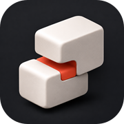

  

<h1 align="center">PocketBuild</h1>

用 iPhone 或 iPad 编译 iOS 插件和 UIKit App。在 Windows 上通过浏览器上传工程、编辑源码和下载产物，编译在手机上完成。

## 安装

PocketBuild 支持 iOS / iPadOS 15.0 及以上。在 [GitHub Actions](https://github.com/qiu7c/PocketBuild/actions/workflows/build-only.yml) 打开最近一次成功的构建，下载 `PocketBuild` 产物并解压，得到 `PocketBuild-0.1.0-unsigned.ipa`。支持 TrollStore 的设备可用 TrollStore 安装，使用证书安装时需先签名。

## 第一次编译

1. **打开 App。** 跟随首次引导设置连接码。常用电脑可以选固定码，临时连接可以选随机码。
2. **安装组件。** 在「组件」选择「常规」，按页面提示安装缺少的「构建资源」和「iOS 16.4 SDK」。安装后可点「试编译 UIKit 示例」确认工具链就绪。试编译结束后会清理临时文件。
3. **连接电脑。** 让 Windows 连接 iPhone 的个人热点，或让两台设备接入同一 Wi-Fi。在手机「工作台」点「启动服务」，用电脑浏览器打开手机显示的地址并输入连接码。
4. **选择工程并编译。** 第一次可新建「UIKit App / IPA」，直接编译生成的示例。已有插件工程可用「导入为新项目」上传整个工程目录。修改源码后先保存，再点「编译」。
5. **下载结果。** 构建期间让 PocketBuild 保持在前台。完成后从浏览器下载 IPA、dylib 或 DEB，也可以在手机「构建」里查看日志和分享产物。生成的 IPA 按设备的安装方式处理签名。

## 遇到问题

- **电脑打不开地址。** 确认电脑已接入手机热点或同一 Wi-Fi，PocketBuild 服务已启动。以工作台显示的地址为准，可以用「连接诊断」查看电脑请求有没有到达手机。
- **构建提示缺少组件。** 从提示进入「组件」补装。使用 iOS 26.0 SDK 编译 C++、Objective-C++ 或 Logos `.xm` 时，还需要 iOS 16.4 SDK 的兼容 C++ 头文件。
- **工程出现编译错误。** 从构建结果打开日志，点击可定位到源码的诊断，修正并保存后重新编译。

## 进一步使用

- [App 工程指南](docs/APP_BUILD.md)介绍代码式 UIKit 工程的配置和支持范围。
- [MCP 使用教程](docs/MCP.md)介绍如何让电脑上的 AI 客户端连接手机并发起构建。
- [PocketBuild 构建指南](docs/BUILDING.md)介绍从源码打包 IPA、托管组件和检查构建。

PocketBuild 由 [Cc](https://github.com/qiu7c) 开发，基于 Dylix 的本机构建核心。详见 [Dylix](https://github.com/yangokok886/dylix)、[版权声明](COPYRIGHT)、[许可证](LICENSE)和[第三方声明](THIRD_PARTY_NOTICES.md)。
